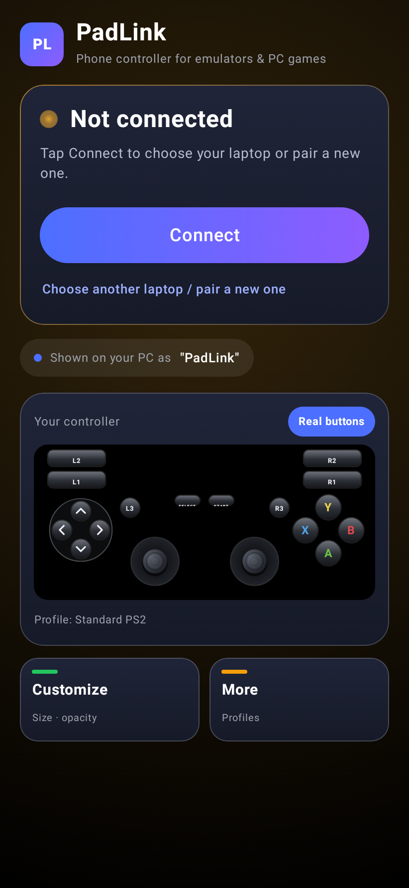
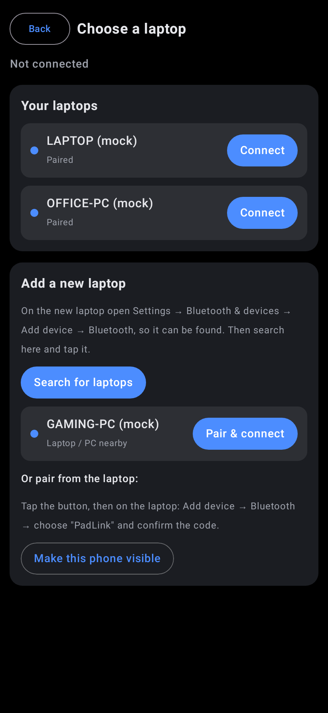
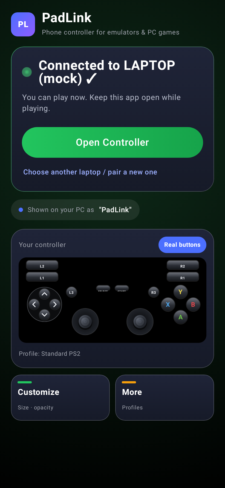
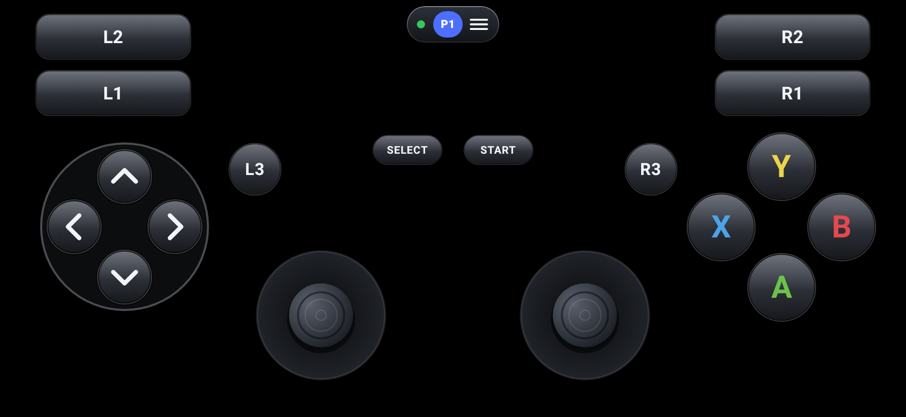
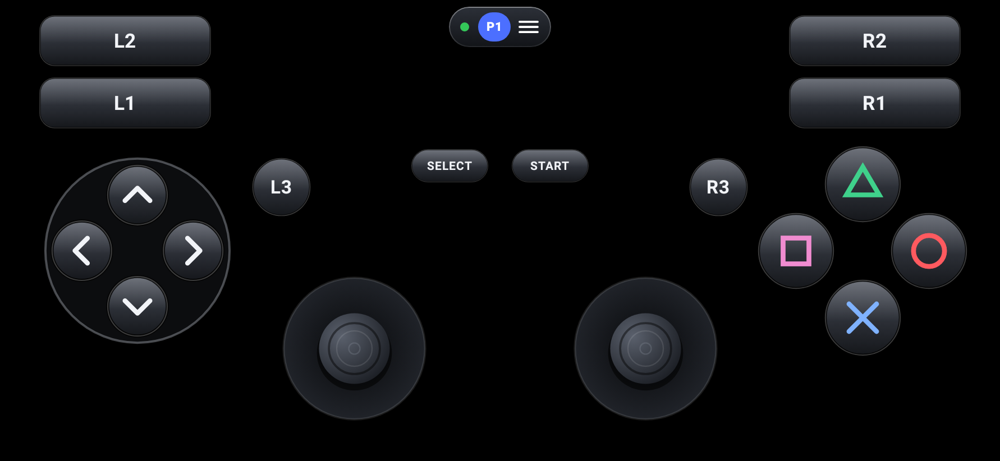
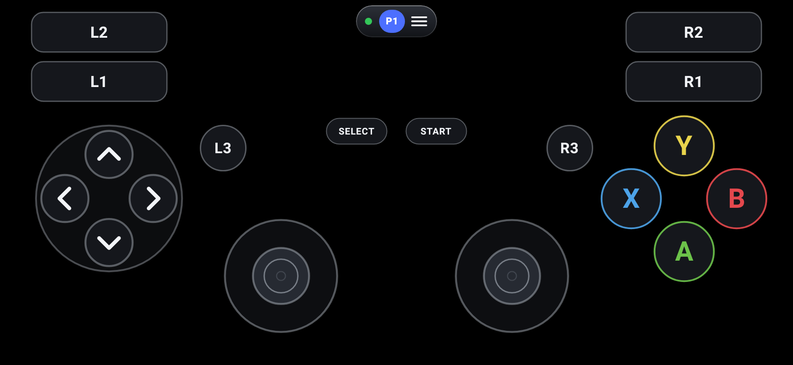
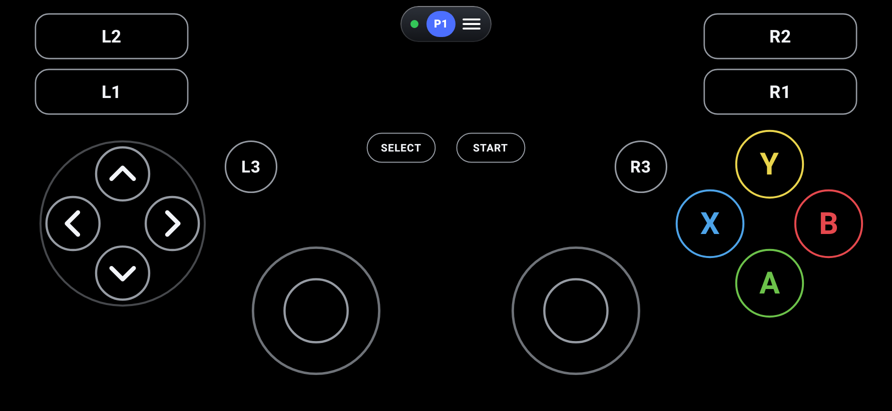
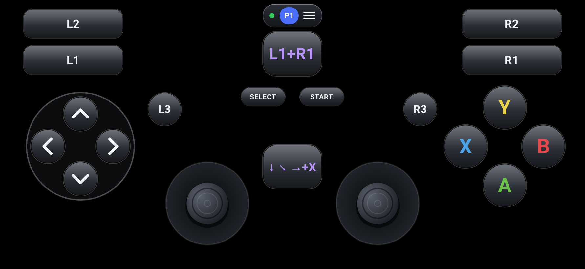
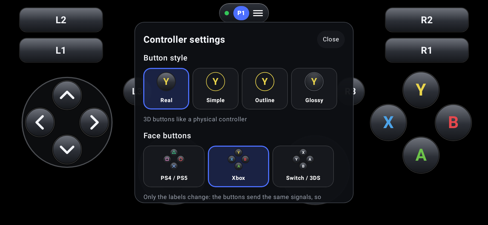

# PadLink: your phone as a Bluetooth controller

**PadLink** turns an Android phone into a simple **Bluetooth game controller** for a Windows PC. Windows
sees a normal game controller, so PCSX2 and other emulators can use it.

**There are two apps. Which one do you need?**

| You want to play… | Install |
|---|---|
| **Emulators** (PCSX2, PPSSPP, Dolphin, RetroArch…) | 📱 **PadLink** on the phone. Nothing on the PC. |
| **PC games and ports** (Steam games, God of War 3 PC port, anything that wants an Xbox controller) | 📱 **PadLink** on the phone **and** 💻 **PadLink Bridge** on the PC |

Both downloads are at the [bottom of this page](#-download).

- Buttons in **3 styles**: **Real** (3D like a physical pad), **Simple** (flat) or **Outline** (rings only)
- Face buttons labelled **Y B A X** or **△ ○ ✕ □**
- **Combo buttons**: press several buttons together (e.g. L1+R1), or play a sequence (e.g. ↓ ↘ → + X)
- **Gyro aiming** for shooters: turn the phone to aim. Switch it with **Gyro ON/OFF** on the controller's top bar
- **Pure black background**: on AMOLED phones black pixels are switched off, which saves battery
- Move, resize and add buttons freely, with up to 5 **loadouts** (one per game)

## ⚡ In 30 seconds

1. Install **PadLink** on your phone ([Download](#-download) at the bottom of this page).
2. Pair the phone with your laptop over Bluetooth (the laptop lists it as **PadLink**).
3. In your emulator, bind each button once.
4. Every next time: open PadLink → tap **Connect** → **Open Controller** → play.
5. Playing PC games or ports (not emulators)? Also install **PadLink Bridge** on the PC
   ([guide](#-pc-games-and-ports-padlink-bridge)). It makes PadLink an Xbox controller.

The full guide below walks you through each step.

## 📖 Step-by-step guide (start here)

**What you need:**
- an **Android phone** (Android 9 or newer) with Bluetooth;
- a **Windows 10/11 laptop or PC** with Bluetooth (built in, or a USB Bluetooth dongle);
- an emulator, for example **PCSX2** for PlayStation 2 games.

Setup takes about 5 minutes the first time. After that you just open the app.

Hold the phone upright (portrait) for the app's menus. When you open the controller, the screen turns
sideways (landscape) by itself; when you leave the controller it turns back.

### Step 1: Install the app on your phone

1. Open this page **on your phone** and tap **⬇️ Download PadLink** at the [bottom of this page](#-download).
2. When the download finishes, tap the notification (or open **Files → Downloads**) and tap `PadLink.apk`.
3. If the phone asks, tap **Settings** → turn on **Allow from this source** → go back → **Install**.
4. If Play Protect warns *"unknown app"*, tap **More details → Install anyway**. It warns because the
   app is not from the Play Store.

### Step 2: Connect the phone to the laptop (first time only)

1. Turn **Bluetooth ON** on both the phone and the laptop.
2. Open **PadLink** on the phone and tap **Allow** when it asks for Bluetooth access.
   The app renames the phone's Bluetooth name to **"PadLink"** so you can find it easily.
3. Tap the big **Connect** button and press **Allow** on the popup (it makes the phone visible to
   the laptop for pairing). PadLink never connects on its own: nothing happens until you tap Connect.
4. On the laptop: **Settings → Bluetooth & devices → Add device → Bluetooth**.
5. Click **PadLink** in the list. A code appears on **both** screens: if it matches, press **Connect**
   on the laptop and **Pair** on the phone.
6. The app shows **Connected ✓**. Done!

> **Two or more laptops?** Tap **Choose another laptop / pair a new one** under the Connect button.
> You get a list of your paired laptops with a **Connect** button on each, **Search for laptops** to find
> and pair a new one from the phone, and **Make this phone visible** to pair from the laptop instead.
> While you pick or pair another laptop, the phone no longer reconnects to the old one by itself.

> **Used an older version before?** On the laptop, go to **Bluetooth & devices → PadLink** (or
> "PS2 Gamepad") **→ ⋯ → Remove device**, then do Step 2 again. Needed only once.

### Step 3: Check that Windows sees the controller

1. On the laptop, press **Win + R**, type `joy.cpl` and press **Enter**.
2. Select **PadLink** → **Properties**.
3. On the phone tap **Open Controller** → pick **Default** → press buttons and move the sticks.
   The numbers and the crosshair in the Windows window should light up and move.

### Step 4: Set it up in your emulator (once per emulator)

**PCSX2 (PlayStation 2):**
1. Keep the phone on the controller screen (PCSX2 only sees it while it is connected).
2. In PCSX2: **Settings → Controllers → Controller Port 1**, choose **DualShock 2**.
3. Click a box, for example **Cross**, then press that button on the phone. Repeat for every button,
   the D-pad and both sticks (move the stick in that direction). The device is listed as **SDL-0**.
4. Close the window: PCSX2 saves it. "Automatic mapping" doesn't work for this kind of controller,
   so bind each button by hand. More help: [PCSX2_CONFIGURATION.md](PCSX2_CONFIGURATION.md).

**Other emulators** (RetroArch, PPSSPP, DuckStation, Dolphin…): open the emulator's
**controller / input settings**, pick **PadLink** (or the generic gamepad), and bind each button the same way.

### Step 5: Play

Every next time: turn on Bluetooth on both devices → open **PadLink** → tap **Connect** (it connects
to the laptop you used last) → when it says **Connected ✓**, tap **Open Controller** → pick your loadout → play. **Keep the app open while you play** (Android stops
Bluetooth controllers that run in the background).

The bar at the top of the controller:

| Button | What it does |
|---|---|
| **Home** | Back to the start screen |
| 🟢 **Connected** | Green = inputs reach the PC. Red banner = not connected |
| **Live** | Shows exactly what is being sent (for checking buttons) |
| **Edit** | Move, resize and add buttons and combos |
| **Settings** | Button style, face labels, gyro options, battery saver, size and opacity |
| **Gyro ON / OFF** | Aim by turning the phone (blue = on) |

Press **Back twice** to leave the controller (one press only shows a hint, so you can't leave by accident).

**Tips while playing:**
- Lift your thumb off a stick and your character stops at once.
- Keep the phone within about 2 metres of the laptop, with nothing metal in between.
- Your phone's normal brightness slider works while playing. Lower brightness saves battery.

**Settings** (tap **Settings** on the top bar; changes apply at once and are saved to the loadout in use):

| Setting | What it does |
|---|---|
| **Button style** | **Real** (3D), **Simple** (flat) or **Outline** (rings only, uses the least battery) |
| **Face buttons** | Show **Y B A X** or **△ ○ ✕ □**. Only the labels change; your emulator bindings stay |
| **Gyro sensitivity** | How much the camera turns when you turn the phone |
| **Game dead-zone fix** | Raise it if small gyro movements do nothing; lower it if the camera creeps by itself |
| **Up/down speed**, **Invert** | Gyro up/down speed, and flipping the gyro directions |
| **Battery saver** | ON = 60 Hz screen and fewer stick updates (buttons stay instant). Less battery and heat |
| **Opacity**, **Button size**, **Joystick size** | Make all buttons more see-through, bigger or smaller |

Scroll down inside the Settings panel to see everything. Tap **Close** to go back to playing.

### Step 6: Make it yours (optional)

- **Button look:** **Settings → Button style**: Real, Simple or Outline. **Face buttons**: Y B A X
  or △ ○ ✕ □. Your emulator bindings don't change.
- **Move or resize buttons:** **Edit** → drag a button. Tap it, then drag the **blue corner** to resize.
  Buttons may overlap. Press **Save**.
- **Add an extra button:** **Edit → + Button**, then choose what it presses (e.g. a second Cross).
- **Combo button:** **Edit → + Combo**. Pick buttons for step 1. For a sequence, tap **+ Step**
  and pick the next buttons/direction. See [Combo buttons](#-combo-buttons).
- **Delete an added button or combo:** **Edit** → tap it → red **✕** → **Save**.
- **One setup per game:** **Open Controller → New loadout** (up to 5). Each keeps its own layout,
  style, combos and gyro.

### Updating PadLink

Download the new version ([Download](#-download)) and install it over the old one. Your loadouts,
layouts and settings stay. You only need to pair again if the guide or the release notes say so.

## 💻 PC games and ports: PadLink Bridge

Emulators accept any controller, but many **PC games and ports only accept Xbox controllers**
(for example the **God of War 3 PC port**, most Steam games). They ignore PadLink, even when it works
in `joy.cpl`. **PadLink Bridge** is a small free Windows app that fixes this: it reads PadLink over
Bluetooth and gives Windows a **virtual Xbox 360 controller**. Games then see a real Xbox controller.

```
PadLink (phone) ──Bluetooth──► PadLink Bridge (PC) ──► Xbox 360 controller ──► any PC game
```

**Set it up once (5 minutes):**

1. Do Steps 1-3 above first (phone app installed, paired, visible in `joy.cpl`).
2. On the PC download **PadLinkBridge.exe** ([Download](#-download), 52 MB). Put it somewhere it can
   stay, for example `Documents\PadLink`.
3. Double-click it. Windows may show **"Windows protected your PC"** (the app is new and not signed):
   click **More info → Run anyway**.
4. The PadLink Bridge window shows 3 steps. Follow them top to bottom:
   - **1. Driver:** click **Install driver** and allow the Windows prompt. This installs **ViGEmBus**,
     the free, widely used driver that creates virtual Xbox controllers. Once only.
   - **2. PadLink:** on the phone tap **Connect** and **Open Controller**. The line turns green:
     **PadLink connected ✓**.
   - **3. Test:** click **Test**. "Test passed ✓" means Windows sees an Xbox controller.
5. **Recommended: Hide the original PadLink from games.** Otherwise some games see *two* controllers
   (PadLink and Xbox) and a button may act twice. Click **Install HidHide** (free driver, once; Windows
   may ask for a restart), connect PadLink, then click **Turn on**.
6. Leave **Start PadLink Bridge with Windows** ticked. It then runs quietly in the tray (the **PL**
   icon next to the clock: grey = waiting, green = Xbox controller active).

**Every next time:** just connect PadLink on the phone. The Bridge is already running and the tray
icon turns green. Start the game. Buttons are already right (no binding needed):

| PadLink | Xbox | PadLink | Xbox |
|---|---|---|---|
| ✕ | A | L1 / R1 | LB / RB |
| ○ | B | L2 / R2 | LT / RT |
| □ | X | Select / Start | Back / Start |
| △ | Y | L3 / R3, D-pad, sticks | L3 / R3, D-pad, sticks |

**Emulators with the Bridge running:** PCSX2 can then also use the Xbox controller (in PCSX2 choose the
**XInput** controller and click **Automatic Mapping**). Your old PadLink bindings keep working unless
you turned on "Hide the original PadLink".

To stop it: right-click the **PL** tray icon → **Exit**. To remove it: untick "Start with Windows",
exit, delete the exe.

## 🛠️ Troubleshooting

| Problem | Fix |
|---|---|
| **PadLink is not in the laptop's Bluetooth list** | On the phone tap **Pair a laptop again / a new laptop** (under Connect), then search again on the laptop within 2 minutes. |
| **Pairs, but never says Connected** | Laptop: **Bluetooth & devices → PadLink → Remove device**. Phone: Bluetooth settings → forget the laptop. Then do Step 2 again. |
| **Connected, but the game doesn't react** | Check `joy.cpl` (Step 3). If it works there, bind the buttons in the emulator (Step 4). |
| **Works in `joy.cpl`, not in a PC game or port** (e.g. God of War 3 PC port) | That game only accepts Xbox controllers. Install **PadLink Bridge** on the PC ([guide](#-pc-games-and-ports-padlink-bridge)). |
| **Bridge: "Windows protected your PC"** | Click **More info → Run anyway**. The app is new and has no paid signing certificate. |
| **Bridge: step 2 stays "Waiting for PadLink"** | On the phone: **Connect**, then **Open Controller**. Check that PadLink shows in `joy.cpl`. If HidHide is on and you just reinstalled the Bridge, click **Turn off** and **Turn on** again. |
| **Bridge: "Could not download" when clicking Install driver** | A short GitHub/internet problem. Click **Install driver** again after a minute (version **1.0.1** or newer also retries by itself). Or click **Yes** in the message: it opens the official download page; download the `.exe` there and run it. |
| **Bridge: "Unhandled exception … 504 (Gateway Time-out)"** | You have version 1.0.0. Download **PadLink Bridge 1.0.1** ([Download](#-download)), which fixes this. |
| **Bridge: Test failed** | Restart the PC once after installing the driver, then click **Test** again. |
| **Bridge: game reacts twice to one press / sees two controllers** | Turn on **Hide the original PadLink from games** in the Bridge window. |
| **Bridge: game still sees nothing** | Start PadLink Bridge and connect PadLink **before** starting the game. Some games only look for controllers at start. |
| **Character keeps moving after I let go of the stick** | Update to **3.2.0** or newer (fixed: the app now sends stick movement at a rate the Bluetooth link can carry, and "stop" always goes first). If it still happens, move the phone closer to the laptop and turn off other Bluetooth devices you aren't using. |
| **Buttons feel slow / laggy** | Update to **3.2.0** or newer (touches go straight to Bluetooth, buttons never wait behind stick movement). USB 3 ports and hubs right next to a Bluetooth dongle can disturb it: use a USB 2 port or a short extension cable for the dongle. |
| **Settings: buttons don't react, can't scroll** | Update to **3.2.0** or newer (fixed). |
| **Stopped working after switching apps** | Go back to PadLink: once you have tapped Connect, it reconnects by itself within a few seconds. Keep it open while playing. |
| **It always connects to the same laptop / I can't see my other laptop** | Tap **Choose another laptop / pair a new one** on the start screen and tap **Connect** next to the laptop you want. A laptop that isn't in the list: tap **Search for laptops** (on the laptop, keep Settings → Bluetooth & devices → Add device open so it can be found), then **Pair & connect**. If pairing from the phone doesn't connect, use **Make this phone visible** and pair from the laptop instead. |
| **Search finds nothing** | Allow **Nearby devices** when asked. On Android 9-11 also turn on **Location** (Android needs it for Bluetooth search). Keep the laptop's **Add device** window open while searching. |
| **Connect says "Waiting for the laptop…" for a long time** | Turn Bluetooth on on the laptop. If the laptop was never paired, add **PadLink** on the laptop (Step 2). After 20 seconds the button comes back so you can try again. |
| **Gyro: small aim does nothing** | **Settings → Game dead-zone fix**: raise it a little. Camera creeps on its own? Lower it. |
| **Gyro: up/down is the wrong way** | **Settings → Invert up/down**. |
| **Phone gets warm / battery drains** | Keep **Battery saver** ON (Settings), lower the phone's brightness, use **Outline** buttons. |
| **Old name "PS2 Gamepad" on the laptop** | Remove the device on the laptop and pair again (Step 2). |


### Screens

| Start screen (portrait) | Choose a laptop | Connected |
|---|---|---|
|  |  |  |

| Real buttons (Y B A X) | Real buttons (△ ○ ✕ □) |
|---|---|
|  |  |
| **Simple buttons** | **Outline buttons** |
|  |  |
| **Combo buttons** | **Making a combo (Edit)** |
|  |  |
| **Settings inside the controller** | **Loadouts (one per game)** |
|  |  |
| **Gyro ON (top bar)** | |
|  | |

---

**Version 3.5.0.** 297 automated tests (294 passed, 3 skipped).
- Confirmed on real hardware by the developer (POCO F6 + Windows 11): registration, pairing,
  Windows game controller test (`joy.cpl`), PCSX2 with manual binding.
- Not yet confirmed on hardware: gyro aiming, button styles, combo buttons, loadouts and the battery saver.
  See [TEST_REPORT.md](TEST_REPORT.md).

## 🎮 Works with emulators

Windows sees PadLink as a standard (DirectInput / HID) game controller with 12 buttons, a D-pad and
two analog sticks. Bind it once in the emulator's controller settings:

- **PCSX2** (PS2): Settings → Controllers → bind each button ([PCSX2_CONFIGURATION.md](PCSX2_CONFIGURATION.md)).
- **RetroArch, PPSSPP, DuckStation, Dolphin** and other emulators with generic controller support:
  pick "PadLink" in their controller settings and bind the buttons.
- Check it first in Windows: press Win+R → `joy.cpl` → PadLink → Properties, and press buttons.
- Games that only accept Xbox (XInput) controllers don't see a generic controller. Add the game to
  **Steam** and turn on Steam Input for generic controllers, or use a tool such as x360ce.

## 🎯 Gyro aiming

Tap **Gyro OFF** on the controller's top bar to turn it **ON** (blue). Then turn the phone to aim:

- **How fast you turn the phone = how fast the camera turns.** Turn slowly for small corrections,
  turn quickly for big turns. Stop turning and the camera stops at once. You don't need to hold the
  phone at a "neutral" angle, and there is no recenter button.
- Left/right = turn the phone left/right (or roll it). Up/down = tilt the top edge towards you
  (look up) or away (look down).
- The right touch stick still works. While your thumb is on it, it wins; when you lift your thumb,
  the gyro takes over again.
- **Settings** (controller → Settings → Gyro aim):
  - **Gyro sensitivity:** higher means less phone movement for the same camera turn.
  - **Game dead-zone fix** (default 20%): most games ignore small stick movements. If small, slow
    aiming does nothing in your game, raise it. If the camera creeps when you barely move, lower it.
  - **Up/down speed**, **Invert up/down** and **Invert left/right**.
- The phone learns its own gyroscope drift by itself whenever you hold it still for a moment.
- Gyro is saved per loadout, so it can be on for shooters and off for other games. The sensors only
  run while the controller is open with gyro ON (not in Edit, not in the background).

Why this is better than the old gyro (1.3 to 2.x): the old one turned the phone's **tilt angle**
into a stick position, with a dead zone of a few degrees. On top of the game's own dead zone, small
aiming corrections did nothing until you tilted a lot, and then the camera jumped. In the simulated
play test, a 2° correction moved the camera 0° with the old method and 3.2° with the new one.

## 🧩 Combo buttons

In the controller tap **Edit → + Combo**, then choose what the combo presses:

- **One step** (e.g. **L1+R1**): all its buttons are pressed together while you hold the combo button.
  All the buttons reach the PC in the same report.
- **Several steps** (tap **+ Step**, e.g. **↓ ↘ → + X**): each tap plays the steps in order. **Step time**
  sets how long each step is held (30–300 ms). If a step repeats a button from the step before, the
  combo releases it briefly first, so the game sees a new press.
- Each step can hold any of the 12 buttons plus one D-pad direction. Drag the combo button anywhere,
  resize it with the blue corner, and delete it with the red ✕. Press **Save**.

## 🔋 Battery and heat

- **Pure black background** everywhere: AMOLED pixels stay off, and only the buttons light up.
  **Outline** buttons light up the fewest pixels.
- **Battery saver** is ON by default (controller → Settings). While the controller is open, it limits
  the screen to **60 Hz** instead of 90/120 Hz and sends stick movement about 60 times a second instead
  of about 80. Buttons and "stick released" are always sent at once. Brightness is left to you: lower
  it with the phone's normal slider.
- No background work: the Bluetooth sender sleeps until a button changes, and the motion sensors
  only run while gyro aiming is ON in the open controller.

| Document | Contents |
|---|---|
| [INSTALLATION.md](INSTALLATION.md) | Install the APK, debug vs release builds, building from source |
| [BLUETOOTH_SETUP.md](BLUETOOTH_SETUP.md) | Compatibility findings, pairing with Windows, joy.cpl, troubleshooting |
| [PCSX2_CONFIGURATION.md](PCSX2_CONFIGURATION.md) | Button/axis mapping and PCSX2 binding |
| [TEST_REPORT.md](TEST_REPORT.md) | Automated results, what is mocked, the hardware test procedure |
| [BUG_REPORT.md](BUG_REPORT.md) | Every bug found, its root cause, fix and regression test |
| [RELEASE_NOTES.md](RELEASE_NOTES.md) | What changed in each version |
| [DEVELOPMENT_PROGRESS.md](DEVELOPMENT_PROGRESS.md) | Phase-by-phase history |

## Features

- **Bluetooth HID gamepad** using Android's public `BluetoothHidDevice` API (Android 9+):
  12 buttons, D-pad (hat switch) and two analog sticks, in one fixed report.
- **Layout:** D-pad, four face buttons (each one separate), L1 L2 R1 R2, Start, Select, L3, R3 and
  two analog sticks. Full multi-touch with per-finger tracking.
- **Button styles:** Real, Simple or Outline, and Y B A X or △ ○ ✕ □ labels. Only the look changes:
  every style sends the same buttons, so emulator bindings stay.
- **Combo buttons:** pressed together or played as a sequence (see above). Up to 12 added buttons and
  combos per loadout, 8 steps per combo.
- **Never-stuck inputs:** everything is released on lift, cancel, app pause, focus loss,
  notification shade, back, loadout switch, layout editing, Bluetooth off and connection loss.
  A failed report is retried with the current state.
- **Loadouts (up to 5):** one saved setup per game. Each keeps its own layout, sizes, opacity,
  button style, sticks and combo buttons.
- **Layout editor:** drag any control, resize it with the blue corner handle, overlap allowed,
  extra buttons (a second Cross, for example) and combos. Layouts adapt to any screen size.
- **Gyro aiming (right stick):** rotation speed to stick, game dead-zone fix, tiered smoothing (no
  lag on real turns), automatic drift learning, 200 Hz gyroscope, on/off on the top bar.
- **Settings inside the controller:** button style, face labels, gyro aim, battery saver, opacity
  of all controls, button size, joystick size.
- **Customization:** opacity of each control, face-button spacing, labels, haptics.
- **Analog settings per stick:** sensitivity, dead zone, max range, response curve, invert Y,
  fixed/floating centre, centre calibration with a live X/Y visualizer.
- **Diagnostics:** every input live, the last HID report, measured report rate and timing.

## Technology

Kotlin 2.1 · Jetpack Compose (BOM 2025.05) · Material 3 · coroutines/StateFlow · MVVM ·
Jetpack DataStore + kotlinx-serialization · AGP 8.13 · minSdk 28, targetSdk 35 · R8 for release.
Tests: JUnit 4, kotlinx-coroutines-test, Robolectric 4.14 + Compose UI test.

## Architecture

```
 Touch (Compose) ──► per-control pointer tracking (ui/controller/PointerTracking.kt)
        │                 D-pad · face buttons · sticks (StickMath) · buttons · combo buttons
        ▼
 ControllerInputManager  ── single source of truth for the controller state, locked; each
        │                   button/direction is held per control (combos never cut a real press)
        ▼  HidReportManager.encode()  (6-byte report, Report ID 1)
 HidDeviceManager        ── BluetoothHidDevice proxy · registerApp · callbacks (own thread)
        │                   sender thread: 4 ms pacing (8 ms in battery saver), axis-only coalescing, retry
        ▼
   Android Bluetooth stack ──► Windows HID game controller ──► PCSX2 / other emulators
```

Source layout: `bluetooth/` (HID layer), `controller/` (input manager, stick maths, layout engine),
`model/`, `settings/` (profiles, persistence), `permissions/`, `ui/` (screens), `ui/controller/` (controller UI).

## Known limitations

- **Keep the app in the foreground.** Android unregisters HID apps that go to the background;
  the app re-registers when you return. The controller screen keeps the display on.
- L2/R2 are digital (no pressure). Sticks are 8-bit with a circular range (diagonal ≈ ±90 per axis).
- No vibration (the HID report has no output/rumble report).
- On its own, Windows sees a generic (DirectInput) controller, not an Xbox (XInput) one. With
  **PadLink Bridge** running, games see an Xbox 360 controller. No vibration in either case.
- Only one app on the phone can be a HID device at a time.

## 📥 Download

There are **two apps**. Download the phone app on your **phone** and the PC app on your **PC**.

### 📱 1. Phone app: needed by everyone

### **[⬇️ Download PadLink for Android (v3.5.0, 2.6 MB)](https://raw.githubusercontent.com/102rupeshsharma/PS2_Emulator/main/download/PadLink.apk)**

Tap the link **on your Android phone**, open the downloaded file and tap **Install**. It installs over an
older version, and your loadouts are kept.

SHA-256: `e244c45e5c50aebb50f0ee634a37404a43c7d5bfcb7ec08fda1061ff9e813315`

### 💻 2. PC app: only for PC games and ports

### **[⬇️ Download PadLink Bridge for Windows (v1.0.1, 52 MB)](https://raw.githubusercontent.com/102rupeshsharma/PS2_Emulator/main/download/PadLinkBridge.exe)**

Click the link **on your Windows 10/11 PC** (64-bit). Not needed for PCSX2 or other emulators. Setup:
[PC games and ports: PadLink Bridge](#-pc-games-and-ports-padlink-bridge).

SHA-256: `77df588bc3ec125e5a46cdfc099723dd34955f0fa0bf2979b92027ff231f00d8`
